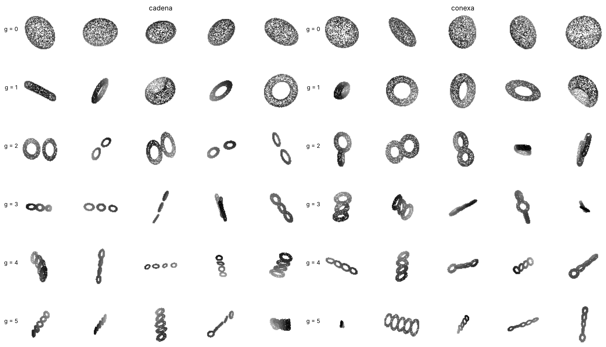
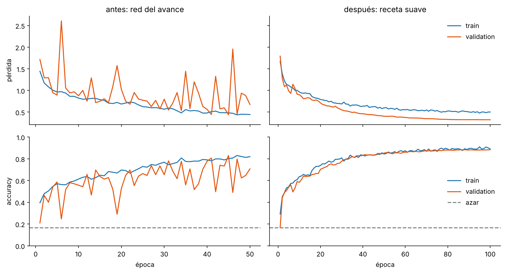
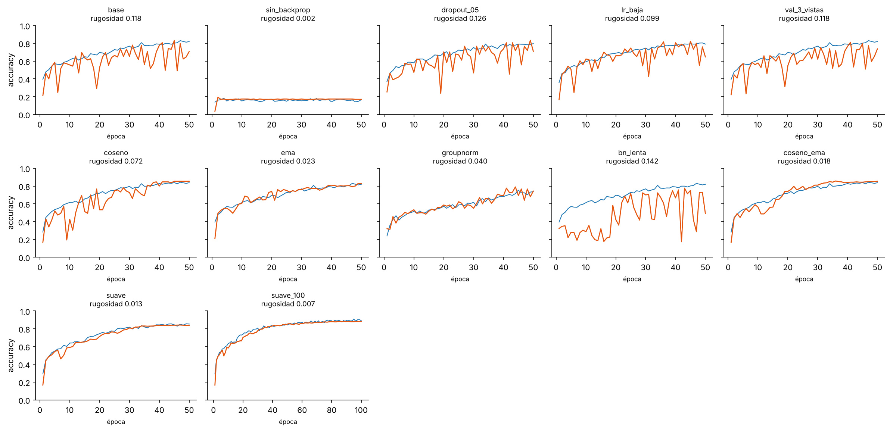
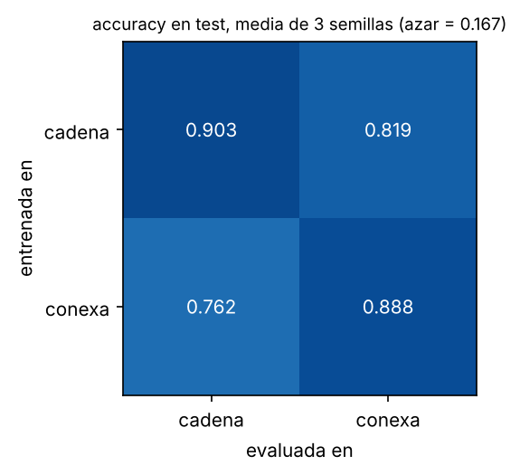
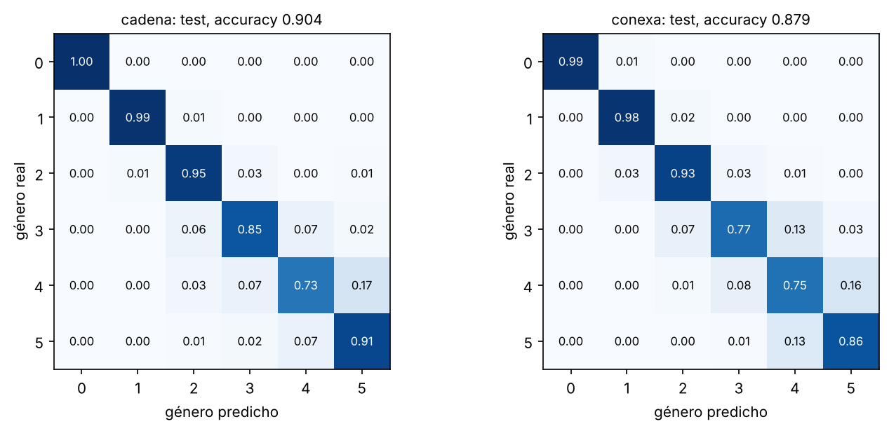

# ¿Una CNN puede contar los huecos de una superficie?

Proyecto final de Sistemas Inteligentes 2 (introducción al deep learning), Universidad El Bosque.

**Autoras:** Sara Valentina Penagos Gamba y [nombre de la compañera].

Una red convolucional recibe una imagen 2D de una nube de puntos y tiene que decir el **género** de la superficie de la que salió: cuántos huecos tiene, de 0 (esfera) a 5. El género es un invariante topológico, así que no cambia si la superficie se estira, se aplasta o se rota. La pregunta del proyecto es si una CNN sencilla puede aprender algo así a partir de imágenes, y qué es lo que mira en realidad cuando acierta.



*Una fila por género. A la izquierda el dataset `cadena` (g toros sueltos) y a la derecha el dataset `conexa` (una sola superficie de género g).*

## Resultados en una mirada

Accuracy en test, sobre familias de superficies que la red nunca vio. La red final se entrenó con tres semillas y se reporta media ± desviación estándar.

| dataset | azar | tinta | silueta | red del avance (por imagen) | red final por imagen | red final por superficie | macro F1 |
|---|---|---|---|---|---|---|---|
| cadena | 0.167 | 0.394 | 0.462 | 0.803 | 0.903 ± 0.004 | 0.974 ± 0.002 | 0.902 ± 0.003 |
| conexa | 0.167 | 0.356 | 0.427 | 0.813 | 0.888 ± 0.008 | 0.971 ± 0.007 | 0.887 ± 0.008 |

- **azar:** 1/6.
- **tinta:** regresión logística que solo ve la proporción de píxeles pintados.
- **silueta:** regresión logística que ve la tinta, el largo, el ancho y qué tan alargada es la mancha. No puede ver ningún hueco.
- **por imagen:** cada una de las 900 imágenes de test cuenta por separado.
- **por superficie:** se promedian las salidas de las 3 vistas de cada superficie antes de decidir.

Lo que cambió desde la revisión de avances:

1. **Se corrigió una inconsistencia del dataset.** Lo que se llamaba género g eran g toros sueltos. Ahora hay además un dataset de superficies de género g de verdad, verificado con la característica de Euler.
2. **Las curvas de validation dejaron de ser puntudas.** El salto medio de la accuracy de validation entre épocas bajó de 0.118 a 0.007, más de 15 veces menos, y de paso la accuracy en test subió de 0.803 a 0.904.
3. **Se comprobó qué cuenta la red.** Una red entrenada solo con toros sueltos acierta 0.819 en superficies conexas que nunca vio. Si contara piezas, ahí fallaría.

## 1. La inconsistencia: género declarado contra género real

Una superficie cerrada y orientable de género g es **una sola pieza** con g huecos, y su característica de Euler es χ = V − E + F = 2 − 2g. Al medir las mallas del dataset original salió otra cosa:

| | dataset original (`cadena`) | dataset corregido (`conexa`) |
|---|---|---|
| qué es la etiqueta g | g toros sueltos en fila | g toros pegados en una sola superficie |
| piezas de la malla | g | 1 |
| χ medida en la malla | 0 (cada toro aporta 0) | 2 − 2g |
| χ que decía el metadata | 2 − 2g | 2 − 2g |

En el dataset original la etiqueta coincide con el número de huecos, pero también con el número de piezas. Entonces no se podía saber si la red contaba huecos o contaba objetos, y lo segundo no tiene nada de topológico.

La corrección está en `src/genuscnn/geometry.py`. Cada toro se describe con su función de distancia, los toros vecinos se colocan con los tubos solapados y los campos se unen con un mínimo suave. La superficie es el nivel cero de ese campo y la malla sale con marching cubes. Después se aplican las mismas deformaciones del dataset original. Cada familia se acepta solo si la malla resultante es una pieza cerrada con χ = 2 − 2g, y los tests lo comprueban para todos los géneros.

El dataset `cadena` se conserva porque es el del avance y porque comparar los dos es lo que permite responder la pregunta de la sección 4.

Otras inconsistencias que se corrigieron:

- La esfera original tenía los polos duplicados y su χ medida daba 0. Ahora los vértices repetidos se sueldan antes de medir y da 2.
- El metadata ahora guarda la χ y el número de piezas **medidos**, no los declarados.
- El cuaderno 3 del avance decía que las superficies de género alto llenan más la imagen. Es al revés: como todas las nubes se escalan al mismo tamaño, una cadena más larga queda más delgada y pinta menos. Está corregido en `notebooks/avance/`.
- El avance concluía que no había sobreajuste porque la accuracy de train y la de validation coincidían en la mejor época. Esa época se elegía sobre una curva que saltaba entre 0.37 y 0.82, así que la coincidencia dependía de en qué pico cayera. Con la curva estable la comparación sí dice algo.
- Las 3 vistas de test de una misma superficie se contaban como 3 aciertos o errores independientes. Ahora se reporta también la accuracy por superficie.
- Validation tenía 1 vista por superficie (300 imágenes). Ahora tiene 3 (900 imágenes).
- Los cuadernos 2 y 3 repetían todo el código. Ahora hay una sola librería con tests y los cuadernos solo la usan.

## 2. La red

Es la misma CNN del avance, con 258 246 parámetros:

- 4 bloques de convolución 3×3, BatchNorm, ReLU y max pooling 2×2. La imagen pasa de 64 a 32, 16, 8 y 4 píxeles, y los canales de 1 a 32, 64, 128 y 128.
- Average pooling global.
- Una capa oculta de 128 neuronas con dropout 0.3 y la salida de 6 neuronas.

Cada nube se centra, se escala para caber en la esfera de radio 1, se rota al azar y se proyecta a una imagen de 64×64 donde el tono es la profundidad. En train cada superficie se ve desde un ángulo nuevo en cada época. En validation y test las vistas son fijas.

El split es **por familia**: las 10 muestras de una familia son la misma superficie deformada de 10 maneras, así que ninguna familia aparece en dos splits. De las 35 familias de cada género, 25 van a train, 5 a validation y 5 a test.

## 3. Por qué las curvas salían puntudas y cómo se arreglaron



Para medir qué tan puntuda es una curva se usa la **rugosidad**: el promedio del salto absoluto entre épocas seguidas, desde la época 6. En la red del avance la accuracy de validation cambiaba en promedio 0.118 de una época a la siguiente, y después de la época 10 llegó a caer hasta 0.290.

Sobre backpropagation: la red del avance ya entrenaba con backpropagation. Es el `loss.backward()` del ciclo de entrenamiento, el paso que calcula cuánto mover cada peso. Se corrió un control con backpropagation apagada (`sin_backprop`) y pasa lo esperado: los pesos se quedan como salieron al azar, la curva queda casi plana y la accuracy de validation se queda alrededor del azar. Una curva plana no sirve si está plana en el azar. Lo que sí se puede cambiar es qué se hace con los gradientes que backpropagation calcula, y eso es lo que prueban los demás experimentos.

Cada experimento cambia una sola cosa frente a la red del avance, con el mismo dataset (`cadena`), el mismo split y la misma semilla. Los últimos combinan las que funcionaron.

| experimento | qué cambia | rugosidad accuracy val | rugosidad pérdida val | test por imagen | test por superficie |
|---|---|---|---|---|---|
| `base` | red del avance, sin cambios | 0.118 | 0.367 | 0.803 | 0.910 |
| `sin_backprop` | control: backpropagation apagada | 0.002 | 0.000 | 0.039 | 0.023 |
| `dropout_05` | dropout 0.3 → 0.5 | 0.126 | 0.369 | 0.829 | 0.927 |
| `lr_baja` | tasa fija 0.001 → 0.0003 | 0.099 | 0.186 | 0.819 | 0.913 |
| `val_3_vistas` | 3 vistas por superficie en validation | 0.118 | 0.367 | 0.826 | 0.923 |
| `coseno` | calentamiento y bajada de la tasa en coseno | 0.072 | 0.235 | 0.843 | 0.950 |
| `ema` | promedio móvil de los pesos | 0.023 | 0.031 | 0.831 | 0.927 |
| `groupnorm` | GroupNorm en lugar de BatchNorm | 0.040 | 0.071 | 0.802 | 0.913 |
| `bn_lenta` | BatchNorm con más memoria (momentum 0.01) | 0.142 | 0.792 | 0.799 | 0.870 |
| `coseno_ema` | coseno + promedio móvil | 0.018 | 0.029 | 0.843 | 0.947 |
| `suave` | coseno + promedio móvil + 3 vistas + suavizado de etiquetas + recorte de gradiente | 0.013 | 0.028 | 0.862 | 0.950 |
| `suave_100` | la receta `suave` con 100 épocas | 0.007 | 0.013 | 0.904 | 0.973 |



Qué dice la tabla:

- **Apagar backpropagation no es una opción.** El control `sin_backprop` tiene la curva más plana de todas (0.002) y no aprende nada: el checkpoint que guarda acierta 0.039 en test.
- **No era ruido de validation.** Triplicar las imágenes de validation deja la rugosidad igual (0.118). Los saltos son de la red, no de la medición.
- **No era falta de regularización.** Subir el dropout a 0.5 no cambia nada (0.126).
- **Bajar la tasa de aprendizaje ayuda poco** si se deja fija (0.099). Con la bajada en coseno la curva se calma solo al final, cuando la tasa ya es pequeña (0.072).
- **BatchNorm tiene que ver.** Al cambiarla por GroupNorm la rugosidad baja a 0.040, y al darle más memoria a sus estadísticas empeora a 0.142. En evaluación BatchNorm usa promedios guardados de batches anteriores. Con una tasa fija y alta los pesos cambian rápido y esos promedios quedan desactualizados, y esa es la lectura que mejor encaja con los dos resultados.
- **Lo que más ayuda es el promedio móvil de los pesos.** En lugar de evaluar los pesos del último paso se evalúa un promedio de los últimos pasos, incluyendo las estadísticas de BatchNorm. Solo con eso la rugosidad baja a 0.023.

La receta final (`configs/suave.yaml`) junta el coseno con calentamiento, el promedio móvil con decaimiento 0.99, validation con 3 vistas, suavizado de etiquetas 0.05, recorte de gradiente a norma 1 y 100 épocas. La arquitectura no cambia.

| | red del avance | receta final |
|---|---|---|
| rugosidad de la accuracy de validation | 0.118 | 0.007 |
| rugosidad de la pérdida de validation | 0.367 | 0.013 |
| accuracy en test por imagen | 0.803 | 0.904 |
| accuracy en test por superficie | 0.910 | 0.973 |

Dos aclaraciones para leer bien la figura. La rugosidad de la receta final se mide sobre 100 épocas y la del avance sobre 50; con 50 épocas la misma receta da 0.013. Y en la receta final la pérdida de validation queda por debajo de la de train porque la de train se calcula con dropout, con etiquetas suavizadas y sobre vistas nuevas, mientras que la de validation usa los pesos promediados sin nada de eso.

En el dataset `conexa` pasa lo mismo: la red del avance tiene rugosidad 0.114 y la receta final 0.014.

## 4. ¿La red cuenta huecos o cuenta piezas?

En `cadena` contar huecos y contar piezas da la misma respuesta. En `conexa` siempre hay una sola pieza, así que solo sirve contar huecos. Cada red final se evaluó en el test del otro dataset, sin reentrenar (media ± desviación de las tres semillas):

| entrenada en | evaluada en | accuracy por imagen | accuracy por superficie | sesgo (predicho − real) |
|---|---|---|---|---|
| cadena | cadena | 0.903 ± 0.004 | 0.974 ± 0.002 | +0.00 |
| cadena | conexa | 0.819 ± 0.009 | 0.912 ± 0.015 | -0.14 |
| conexa | cadena | 0.762 ± 0.006 | 0.830 ± 0.003 | +0.20 |
| conexa | conexa | 0.888 ± 0.008 | 0.971 ± 0.007 | +0.01 |



- Una red que solo vio toros sueltos acierta 0.819 en superficies conexas. Si hubiera aprendido a contar piezas, ahí todo le parecería género 0 o 1 y estaría cerca del azar (0.167). **Lo que aprendió se parece mucho más a contar huecos que a contar piezas.**
- Al revés también se transfiere, aunque menos: 0.762.
- Los errores tienen dirección. La red de `cadena` evaluada en `conexa` tiende a predecir géneros de menos (sesgo -0.14) y la de `conexa` evaluada en `cadena` tiende a predecir de más (sesgo +0.20). Una lectura posible es que al pegar los toros las juntas tapan parte de los huecos, y que al separarlos los espacios entre toros vecinos parecen huecos extra.
- La línea base de la silueta se queda en 0.462 y 0.427, muy por debajo de la red. La red no acierta solo por lo larga o lo delgada que se ve la mancha.



Los géneros 0 y 1 se reconocen casi siempre. Los errores se concentran en los géneros 3, 4 y 5 (el 4 es el más difícil) y más de 8 de cada 10 son por un solo género. Desde ciertos ángulos un hueco queda tapado por otro.

## 5. Límites del trabajo

- Todas las superficies son cadenas rectas de toros. El largo de la cadena crece con el género en los dos datasets, y aunque la línea base de la silueta muestra que eso no basta para explicar el resultado, el experimento del cruce descarta el atajo de contar piezas y no todos los atajos posibles. El siguiente paso sería generar superficies de género g con otras formas (en anillo, ramificadas) o volver a EuLearn con esta receta.
- El zip original de 300 superficies no está en el repositorio. Los resultados de este README usan un dataset `cadena` generado completo con el método replicado (35 familias por género). Si se pone `topology_dataset.zip` en `data/`, el script conserva las 300 originales y genera las familias 05 a 34 con las mismas semillas del cuaderno de ampliación, y los números pueden cambiar un poco.
- La receta final se eligió mirando la validation del dataset `cadena` con una semilla. La tabla del estudio muestra también el test de cada experimento, así que ese test se miró más de una vez. Las cifras con tres semillas de la primera tabla son las más confiables.
- Todo se entrenó en CPU con una sola arquitectura. Una corrida de 100 épocas tarda unos 15 a 20 minutos.

## Estructura del repositorio

```
cnn-genero-superficies/
├── README.md
├── requirements.txt
├── pyproject.toml
├── configs/
│   ├── base.yaml                  red del avance
│   └── suave.yaml                 receta final
├── src/genuscnn/
│   ├── geometry.py                mallas, superficies conexas, topología, deformaciones
│   ├── generate.py                genera los datasets cadena y conexa
│   ├── data.py                    manifest, split por familia, nube → imagen
│   ├── model.py                   la CNN
│   ├── training.py                entrenamiento, scheduler, promedio móvil, evaluación
│   ├── metrics.py                 rugosidad, resumen de clasificación, voto por superficie
│   ├── baselines.py               línea base de la silueta
│   ├── plots.py                   figuras
│   └── config.py                  lectura de configuraciones
├── scripts/
│   ├── generate_dataset.py        crea data/cadena y data/conexa
│   ├── train.py                   entrena una configuración
│   ├── smoothing_study.py         los 12 experimentos de suavizado
│   ├── final_runs.py              corridas finales con tres semillas
│   ├── evaluate_cross.py          cruce entre datasets
│   ├── shape_baselines.py         líneas base de tinta y silueta
│   ├── make_figures.py            figuras del README
│   └── check_comments.py          revisa que cada línea de código tenga comentario
├── tests/                         50 tests con pytest
├── notebooks/
│   ├── 01_datasets.ipynb          los dos datasets y su topología
│   ├── 02_resultados.ipynb        curvas, estudio de suavizado y cruce
│   └── avance/                    los tres cuadernos de la revisión de avances
├── results/                       historiales, métricas, tablas y figuras de las corridas
└── data/                          aquí se generan los datasets (no se suben a git)
```

## Cómo reproducir

En PowerShell, desde la carpeta del repositorio:

```powershell
python -m venv .venv
.\.venv\Scripts\Activate.ps1
pip install -r requirements.txt

python scripts/generate_dataset.py      # genera data/cadena y data/conexa (menos de un minuto)
pytest -q                               # 50 tests

python scripts/train.py --config configs/suave.yaml --variant conexa --name prueba
```

Para repetir todos los resultados (en CPU son varias horas):

```powershell
python scripts/smoothing_study.py       # estudio de suavizado
python scripts/final_runs.py            # corridas finales con tres semillas
python scripts/evaluate_cross.py         # cruce entre datasets
python scripts/shape_baselines.py       # líneas base de tinta y silueta
python scripts/make_figures.py          # figuras
```

Los scripts saltan lo que ya está hecho, así que se pueden interrumpir y volver a correr. Si se tiene el zip original, va en `data/topology_dataset.zip` antes de generar.

## Sobre el código

Todos los archivos de código están comentados línea por línea, con el comentario a la derecha. `python scripts/check_comments.py` lo revisa y también corre en GitHub Actions junto con los tests. El único archivo donde los comentarios van arriba y no a la derecha es `.gitignore`, porque git no permite comentarios al final de la línea ahí.
